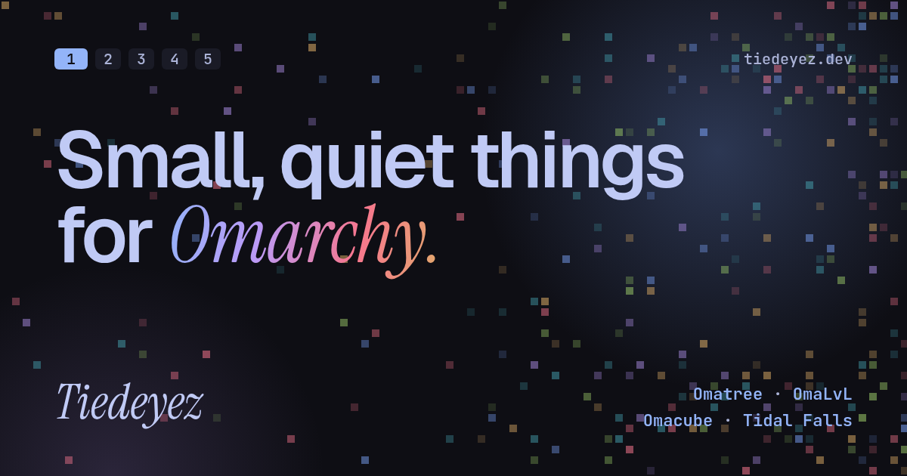

<a href="https://tiedeyez.dev"></a>

# Tiedeyez

Plugins, themes, and small quiet things for [Omarchy](https://omarchy.org). All four are listed on the
[Omarchy plugin marketplace](https://omarchyplugins.com/), and every repo ships a `DISCLOSURE.md` saying what it reads, writes and runs.

| | Plugin | What it is | Latest |
| --- | --- | --- | --- |
| 01 | **[Omatree](https://github.com/Tiedeyez/omatree)** | A living bonsai on your bar, grown from a seed unique to your machine. Prune it by hand, graft a friend's cutting. No two alike. | [v1.5.0](https://github.com/Tiedeyez/omatree/releases/tag/v1.5.0) |
| 02 | **[OmaLvL](https://github.com/Tiedeyez/omalvl)** | Level up by using your machine: 17 skills in six areas, a Rice rating, theme seasons, and quests that teach Omarchy and Linux. | [v1.0.8](https://github.com/Tiedeyez/omalvl/releases/tag/v1.0.8) |
| 03 | **[Omacube](https://github.com/Tiedeyez/omacube)** | Your desktop as a 3&times;3 puzzle cube. An endless stack of legal cube states, coloured from your theme, rolling as you switch workspaces. | [v0.4.0](https://github.com/Tiedeyez/omacube/releases/tag/v0.4.0) |
| 04 | **[Tidal Falls](https://github.com/Tiedeyez/tidal)** | A 16-bit waterfall behind your windows. The top bar is the brink, and the wordmark rises from the water. | [v1.0.0](https://github.com/Tiedeyez/tidal/releases/tag/v1.0.0) |

Install any of them with one command, for example:

```bash
omarchy plugin add https://github.com/Tiedeyez/omatree.git --enable
```

More, with a live theme switcher, at **[tiedeyez.dev](https://tiedeyez.dev)**.

---

### Supporting Open Omarchy

Backing the Open Machine — Rally Support Division, Limited Patron Series, Class 016.

<p>
  
  
</p>
